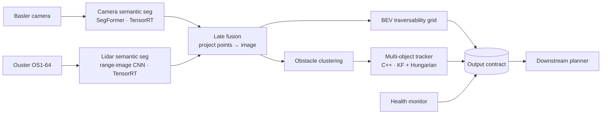

# Off-Road Perception Stack — Reference Architecture

An end-to-end, edge-deployed perception system for an off-road machine:
camera + lidar → semantic fusion → traversability map + tracked obstacles → downstream planner.
Built on RELLIS-3D, deployed on NVIDIA Jetson with TensorRT, replayable from recorded data.

> The goal is a **system**, not a SOTA model: clear contracts, measured tradeoffs,
> documented failure modes, and a latency budget that holds on edge hardware.

## Architecture

## Output contract (summary)
| Topic | Type | Rate | Consumer guarantee |
|---|---|---|---|
| `/perception/traversability` | `perception_msgs/TraversabilityGrid` | 10 Hz | Cost + confidence per cell; unknown is explicit, never 0-cost |
| `/perception/obstacles` | `perception_msgs/ObstacleArray` | 10 Hz | Stable track IDs, covariance, existence probability |
| `/perception/health` | `perception_msgs/PerceptionHealth` | 10 Hz | Per-sensor status + current degraded mode |

Full spec: [docs/interface_contract.md](docs/interface_contract.md)

## Measured so far (week 1)
Every number links to the measurement file it came from.

*RELLIS-3D sequence 00004, frame 104. Lidar ground-truth classes agree with the image labels at
74–89 % of projected points per sequence, and agreement peaks at the nominal yaw
([projection_check.json](docs/measurements/projection_check.json)).*

| Component | Model | Test mIoU | Source |
|---|---|---|---|
| Camera seg | SegFormer-B0, 640×1024, fine-tuned | 42.7 (19 classes) | [camera_segformer_b0_test.json](docs/measurements/camera_segformer_b0_test.json) |
| Lidar seg | SalsaNext, released RELLIS-3D weights, no KNN | 41.8 (14 classes) | [lidar_salsanext_test.json](docs/measurements/lidar_salsanext_test.json) |

| Sensor fact (bag 00004) | Value | Why it matters |
|---|---|---|
| Camera horizontal FOV | 37.7° (10.5 % of lidar azimuth) | Lidar is the primary 360° source ([ADR-0002](docs/adr/0002-late-fusion.md)) |
| Camera − lidar stamp offset | median −22.8 ms (00004), −41.2 ms (00001); ≥99.9 % within ±50 ms | Window holds, but the offset varies per recording, so fusion compensates per pair |
| Lidar scan age on arrival | median 127 ms (stamp = sweep start) | Output-age bound under review ([ADR-0005](docs/adr/0005-output-age-guarantee.md)) |

## Latency budget (target, Jetson Orin NX, 10 Hz lidar)
| Stage | Budget (ms) | Measured (ms) |
|---|---|---|
| Camera seg | 30 | 35.0 * |
| Lidar seg | 20 | **44.2** * |
| Fusion + BEV | 15 | — |
| Clustering + tracking | 10 | — |
| Transport + slack | 25 | — |
| **End-to-end** | **100** | — |

\* Preliminary: TensorRT FP16 GPU compute median, MAXN, with other workloads running on the board
([jetson_trt_models.txt](docs/measurements/jetson_trt_models.txt)). Both models are over budget, and
lidar seg by 2.2×. A quiet-board re-measure is pending.

## Repo layout
- `src/perception_msgs/` — the contract (ROS 2 interfaces)
- `docs/adr/` — architecture decision records
- `docs/measurements/` — every measured number, as JSON; `docs/figures/` — figures generated from them
- `docs/` — interface contract, cost table, Jetson setup, ODD and hazard analysis (week 4)
- `config/` — sensor frames, rates, extrinsics, class → cost table
- `ml/` — training, evaluation, ONNX export, projection (Python, server side)
- `env/` — pinned server environment; `scripts/` — data download, bag conversion, SLURM jobs, Jetson checks
