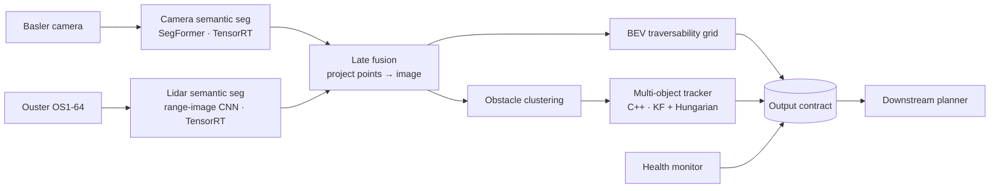

# Off-Road Perception Stack — Reference Architecture

An end-to-end, edge-deployed perception system for an off-road machine:
camera + lidar → semantic fusion → traversability map + tracked obstacles → downstream planner.
Built on RELLIS-3D, deployed on NVIDIA Jetson with TensorRT, replayable from recorded data.

> The goal is a **system**, not a SOTA model: clear contracts, measured tradeoffs,
> documented failure modes, and a latency budget that holds on edge hardware.

## Architecture

## Output contract (summary)
| Topic | Type | Rate | Consumer guarantee |
|---|---|---|---|
| `/perception/traversability` | `perception_msgs/TraversabilityGrid` | 10 Hz | Cost + confidence per cell; unknown is explicit, never 0-cost |
| `/perception/obstacles` | `perception_msgs/ObstacleArray` | 10 Hz | Stable track IDs, covariance, existence probability |
| `/perception/health` | `perception_msgs/PerceptionHealth` | 10 Hz | Per-sensor status + current degraded mode |

Full spec: [docs/interface_contract.md](docs/interface_contract.md)

## Latency budget (target, Jetson, 10 Hz lidar)
| Stage | Budget (ms) | Measured (ms) |
|---|---|---|
| Camera seg | 30 | — |
| Lidar seg | 20 | — |
| Fusion + BEV | 15 | — |
| Clustering + tracking | 10 | — |
| Transport + slack | 25 | — |
| **End-to-end** | **100** | — |

## Repo layout
- `src/perception_msgs/` — the contract (ROS 2 interfaces)
- `docs/adr/` — architecture decision records
- `docs/` — interface contract, ODD, hazard analysis (week 4)
- `config/` — sensor frames, rates, thresholds
- `scripts/` — data prep and bag conversion
