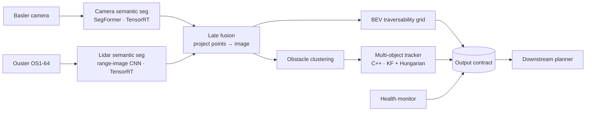
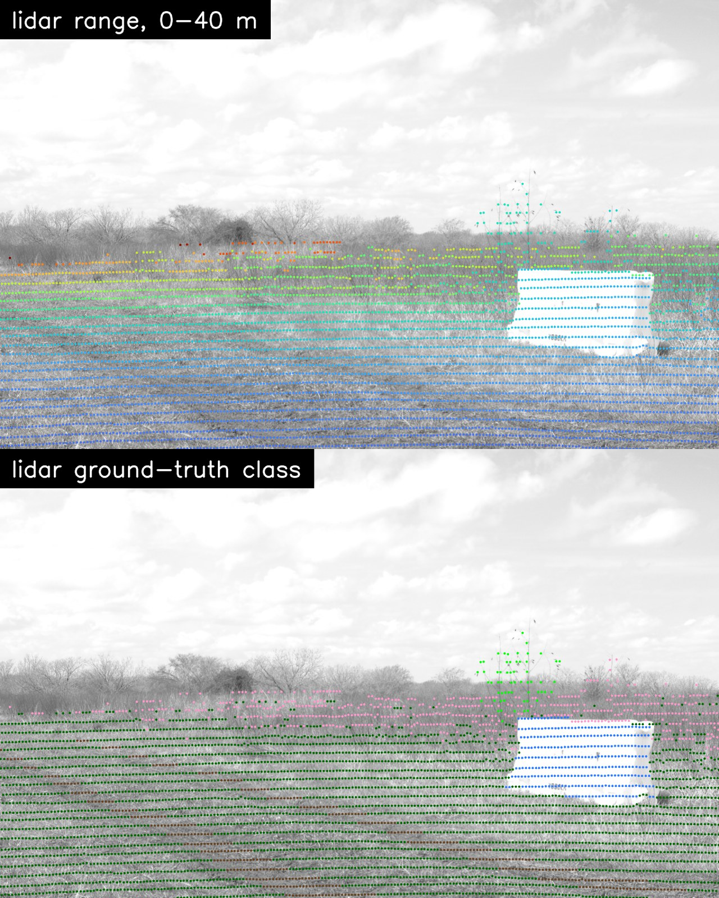
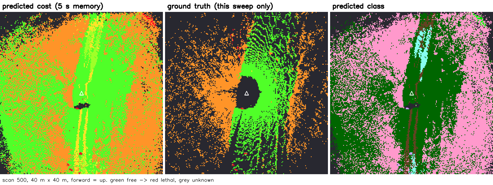

# Off-Road Perception Stack — Reference Architecture

An end-to-end, edge-deployed perception system for an off-road machine:
camera + lidar → semantic fusion → traversability map + tracked obstacles → downstream planner.
Built on RELLIS-3D, deployed on NVIDIA Jetson with TensorRT, replayable from recorded data.

> The goal is a **system**, not a SOTA model: clear contracts, measured tradeoffs,
> documented failure modes, and a latency budget that holds on edge hardware.

## Architecture

## Output contract (summary)
| Topic | Type | Rate | Consumer guarantee |
|---|---|---|---|
| `/perception/traversability` | `perception_msgs/TraversabilityGrid` | 10 Hz | Cost + confidence per cell; unknown is explicit, never 0-cost |
| `/perception/obstacles` | `perception_msgs/ObstacleArray` | 10 Hz | Stable track IDs, covariance, existence probability |
| `/perception/health` | `perception_msgs/PerceptionHealth` | 10 Hz | Per-sensor status + current degraded mode |

Full spec: [docs/interface_contract.md](docs/interface_contract.md)

## Measured so far (week 1)
Every number links to the measurement file it came from.

*RELLIS-3D sequence 00004, frame 104. Lidar ground-truth classes agree with the image labels at
74–89 % of projected points per sequence, and agreement peaks at the nominal yaw
([projection_check.json](docs/measurements/projection_check.json)).*

| Component | Model | Test mIoU | Source |
|---|---|---|---|
| Camera seg | SegFormer-B0, 640×1024, fine-tuned | 42.7 (19 classes) | [camera_segformer_b0_test.json](docs/measurements/camera_segformer_b0_test.json) |
| Lidar seg | SalsaNext, released RELLIS-3D weights, no KNN | 41.8 (14 classes) | [lidar_salsanext_test.json](docs/measurements/lidar_salsanext_test.json) |

| Sensor fact (bag 00004) | Value | Why it matters |
|---|---|---|
| Camera horizontal FOV | 37.7° (10.5 % of lidar azimuth) | Lidar is the primary 360° source ([ADR-0002](docs/adr/0002-late-fusion.md)) |
| Camera − lidar stamp offset | median −22.8 ms (00004), −41.2 ms (00001); ≥99.9 % within ±50 ms | Window holds, but the offset varies per recording, so fusion compensates per pair |
| Lidar scan age on arrival | median 127 ms (stamp = sweep start) | Output-age bound under review ([ADR-0005](docs/adr/0005-output-age-guarantee.md)) |

## Measured so far (week 2): fusion, grid, tracking on held-out data
Replay of RELLIS-3D sequence 00001 through the reference pipeline. Settings were chosen on its val block
and are reported on its test block (105 s, 1,047 scans), which neither model trained on.

| Result (00001 test) | Value | Source |
|---|---|---|
| Point mIoU inside the camera wedge, lidar only → fused | 30.9 → **34.5** (classes ≥10k pts: 53.7 → **59.1**) | [fusion_00001.json](docs/measurements/fusion_00001.json) |
| Truly lethal cells marked lethal / marked free | **88.8 %** / 1.7 % | [replay_00001_summary.json](docs/measurements/replay_00001_summary.json) |
| Free cells marked lethal | 0.8 % | same |
| Forward corridor UNKNOWN 0.9–2 m ahead: single sweep → 5 s memory | 100 % → **9 %** | same, [ADR-0008](docs/adr/0008-grid-memory.md) |
| Tracking: MOTA / IDF1 / ID switches (66 objects) | **0.59 / 0.56 / 41** | [tracking_00001_test.json](docs/measurements/tracking_00001_test.json) |
| C++ runtime core vs Python reference | identical in all 9 stages | [cpp_parity.json](docs/measurements/cpp_parity.json) |

Findings that shaped the design: the camera frame must be matched to the lidar's sweep of the camera's view,
not the scan stamp; the lidar sees the machine's own antennas (ego filter); a single-sweep grid leaves the
near field permanently UNKNOWN, so a contract-following planner could never move (grid memory); and
RELLIS-3D's lidar labels mark ground where people walked as `person` (ADR-0009).

## Latency budget (target, Jetson Orin NX, 10 Hz lidar)
| Stage | Budget (ms) | Measured (ms) |
|---|---|---|
| Camera seg (SegFormer-B0 480×768 FP16) | 30 | 20.0 * |
| Lidar seg (SalsaNext FP16) | 20 | **49.1** * |
| Fusion + BEV | 15 | — |
| Clustering + tracking | 10 | — |
| Transport + slack | 25 | — |
| **End-to-end** | **100** | — |

\* TensorRT GPU compute median per model, measured alone (MAXN, clocks locked;
[jetson_latency_sweep.txt](docs/measurements/jetson_latency_sweep.txt)). The deployment configuration is
ADR-0010. Lidar seg is 2.5× over its stage budget, a recorded overrun: INT8 was rejected after ten
calibration variants (the best loses 2.7 mIoU and a third of vehicle IoU). The other rows are filled from the second on-device replay. The first replay, with a
640×1024 camera model, took 150 ms per scan and could not keep up with the sensor
([jetson_replay_run1.txt](docs/measurements/jetson_replay_run1.txt)).

## Repo layout
- `src/perception_msgs/` — the contract (ROS 2 interfaces)
- `docs/adr/` — architecture decision records
- `docs/measurements/` — every measured number, as JSON; `docs/figures/` — figures generated from them
- `docs/` — interface contract, cost table, Jetson setup, ODD and hazard analysis (week 4)
- `config/` — sensor frames, rates, extrinsics, class → cost table
- `ml/` — training, evaluation, ONNX export, projection (Python, server side)
- `env/` — pinned server environment; `scripts/` — data download, bag conversion, SLURM jobs, Jetson checks
