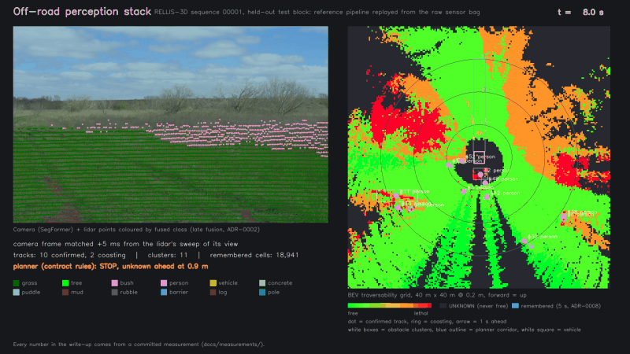
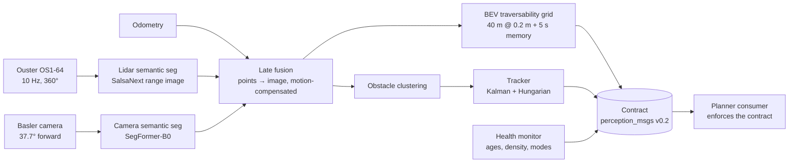
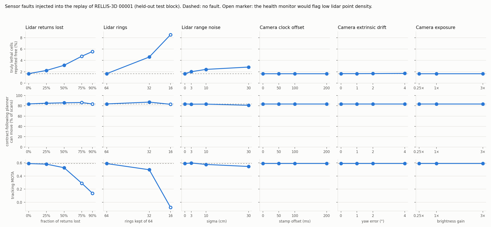

# Off-Road Perception Stack — a reference architecture on RELLIS-3D

Camera + lidar → semantic fusion → traversability grid + tracked obstacles → a planner that consumes a written
contract, with a health monitor, an operational design domain, a hazard analysis and a decision record for
every non-trivial choice. Built on the RELLIS-3D off-road dataset, replayed from the raw sensor bags, with a
C++/TensorRT runtime brought up on a Jetson Orin NX.

> The goal is a **system**, not a state-of-the-art model: clear contracts, measured trade-offs, documented
> failure modes, and evidence for every claim. Every number below links to the file that measured it.



*Held-out RELLIS-3D sequence 00001. Left: camera image with lidar points coloured by their fused class.
Right: 40 m × 40 m traversability grid (green free → red lethal, dark = UNKNOWN, blue tint = remembered),
tracked people with 1 s velocity arrows, and the corridor a contract-following planner checks.*

## At a glance

| | Result (held-out test block, 1,047 scans) | Source |
|---|---|---|
| Fusion | Point mIoU in the camera view: lidar alone 30.9 → fused **34.5** (classes ≥10k points: 53.7 → **59.1**) | [fusion_00001.json](docs/measurements/fusion_00001.json) |
| Grid safety | Truly lethal cells reported lethal **88.8 %**, reported free **1.7 %**; free reported lethal 0.8 % | [replay_00001_summary.json](docs/measurements/replay_00001_summary.json) |
| Tracking | MOTA **0.59**, IDF1 0.56, 41 ID switches over 66 objects | [tracking_00001_test.json](docs/measurements/tracking_00001_test.json) |
| Planner | A planner that follows the contract can move in **84 %** of scans | [robustness_00001_test.json](docs/measurements/robustness_00001_test.json) |
| Robustness | 18 fault-injected replays: lidar faults degrade safety **silently**; camera faults cost at most the camera's own contribution | same, [figure](docs/figures/robustness.png) |
| Runtime | C++ core identical to the Python reference in all 9 stages; runs end to end on the Orin NX | [cpp_parity.json](docs/measurements/cpp_parity.json), [jetson_replay_run1.txt](docs/measurements/jetson_replay_run1.txt) |

## Scope
- **Is:** an end-to-end perception system for a slow off-road machine (≤ 2 m/s), with an explicit output contract,
  degraded modes, and the measurements to back each design decision.
- **Is not:** a new model. Both networks are off the shelf (SegFormer-B0 fine-tuned; SalsaNext released weights).
  RELLIS-3D has semantic labels only, so the system builds a traversability map and tracks clusters instead
  of detecting 3D boxes ([ADR-0001](docs/adr/0001-semantic-fusion-over-box-detection.md)).
- **Data discipline:** RELLIS-3D splits by sequence, so all system metrics use sequence 00001: settings chosen on
  its val block, results reported on its test block, which neither model trained on
  ([split_by_sequence.json](docs/measurements/split_by_sequence.json)).

## Architecture



| Stage | Implementation | Decision |
|---|---|---|
| Lidar segmentation | SalsaNext on the 64 × 2048 range image, 14 classes, test mIoU 41.8 | [ADR-0003](docs/adr/0003-lidar-model-salsanext.md) |
| Camera segmentation | SegFormer-B0 fine-tuned on RELLIS-3D, 19 classes, test mIoU 42.7 (41.1 at the deployed 480×768) | [ADR-0004](docs/adr/0004-camera-model-segformer-b0.md), [ADR-0010](docs/adr/0010-deployment-model-configuration.md) |
| Fusion | Late fusion in the RELLIS ontology: log-linear pooling of per-point distributions, lidar primary; camera frame matched to when the lidar swept its view | [ADR-0002](docs/adr/0002-late-fusion.md) |
| Grid | 40 m × 40 m at 0.2 m; class cost + height-above-ground check (lethal regardless of class); UNKNOWN is explicit; static evidence remembered 5 s for the lidar's blind near field | [ADR-0007](docs/adr/0007-bev-grid-parameters.md), [ADR-0008](docs/adr/0008-grid-memory.md) |
| Tracking | Clusters of obstacle-class points; constant-velocity Kalman filter in the odom frame, Hungarian assignment, existence probability, COASTING state | [ADR-0009](docs/adr/0009-tracking-and-its-evaluation.md) |
| Health | Per-sensor age and density; NOMINAL / LIDAR_ONLY / SAFE_STOP; output age bound | [ADR-0005](docs/adr/0005-output-age-guarantee.md) |
| Runtime | ROS 2 components in one process (C++17, TensorRT); sensor queues of one: a node that falls behind drops stale scans | [ADR-0011](docs/adr/0011-newest-input-wins.md) |

The same pipeline exists twice: a Python reference that replays the bags on a server and scores everything, and a
ROS-free C++ core inside the ROS 2 nodes. The C++ core matches the reference stage by stage
([cpp_parity.json](docs/measurements/cpp_parity.json)), so offline metrics carry over to the runtime.

## Output contract
Full spec: [docs/interface_contract.md](docs/interface_contract.md). Messages: [src/perception_msgs](src/perception_msgs).

| Topic | Type | Content |
|---|---|---|
| `/perception/traversability` | `TraversabilityGrid` | Cost, class, confidence and source flags per cell, in `base_link` |
| `/perception/obstacles` | `ObstacleArray` | Tracks with stable IDs, velocity, covariance, existence probability, state |
| `/perception/health` | `PerceptionHealth` | Per-sensor status and the current mode |

Rules a consumer must follow (each one exists because of a failure it prevents):
1. `cost == 255` is UNKNOWN and is never free space.
2. Obstacles count only above an existence-probability gate; COASTING tracks are predictions only.
3. `MODE_SAFE_STOP` overrides everything.
4. `header.stamp` is the lidar sweep start, never the publish time; consumers predict forward by the observed age.
5. **Missing output means stop.** Lidar loss produces no grids at all, so a consumer that only acts per grid
   would keep its last command. The reference planner has a watchdog for this.

The reference planner ([planner_consumer_node.cpp](src/offroad_perception/src/planner_consumer_node.cpp),
Python port [pipeline/planner.py](pipeline/planner.py)) implements these rules and runs in every replay. On the
test block it can move in 84 % of scans; it stops for an UNKNOWN cell in the corridor in 10 % and for a lethal
cell in 6 %.

## Results on held-out data


| Result (00001 test) | Value | Source |
|---|---|---|
| Point mIoU in the camera view, lidar only → fused | 30.9 → **34.5** (classes ≥10k pts: 53.7 → **59.1**) | [fusion_00001.json](docs/measurements/fusion_00001.json) |
| Truly lethal cells reported lethal / reported free | **88.8 %** / 1.7 % | [replay_00001_summary.json](docs/measurements/replay_00001_summary.json) |
| Free cells reported lethal | 0.8 % | same |
| Forward corridor UNKNOWN 0.9–2 m ahead: single sweep → 5 s memory | 100 % → **9 %** | same, [ADR-0008](docs/adr/0008-grid-memory.md) |
| Tracking: MOTA / IDF1 / ID switches (66 objects) | **0.59 / 0.56 / 41** | [tracking_00001_test.json](docs/measurements/tracking_00001_test.json) |
| Per-class tracking recall (existence gate 0.5), people / vehicles | 0.92 / **0.20** (vehicles: top hazard H-9) | same |

There are no ground-truth tracks in RELLIS-3D. Tracking is scored against pseudo-ground truth built from the
labelled points with the same clustering, linked by a deliberately different method, with documented don't-care
rules ([ADR-0009](docs/adr/0009-tracking-and-its-evaluation.md)).

## Robustness: fault injection
Sensor faults injected into the replayed data before any perception code sees it, ground truth always from the
clean data ([pipeline/faults.py](pipeline/faults.py), 18 runs of the full test block,
[robustness_00001_test.json](docs/measurements/robustness_00001_test.json)).



- **Lidar faults degrade safety silently.** With 50 % of returns lost, truly lethal cells reported free rise from
  1.67 % to 3.14 %; with 32 rings instead of 64, to 4.60 %. Yet a contract-following planner moves *as often or
  more often* (84 → 86–87 % of scans), and the health monitor's density threshold fires only at ≥ 75 % loss.
  Neither the planner nor the monitor gets a signal. This is now the joint-top hazard (H-14), with a concrete
  fix: a density check against a rolling nominal instead of a fixed floor.
- **Camera faults are contained by design.** A 200 ms clock offset, 4° of extrinsic drift, or 0.25×–3× exposure
  leave grid safety and tracking unchanged; the worst case (4° drift) brings in-view mIoU from 34.5 back to 30.9,
  exactly lidar-only. Making the lidar primary and the camera a refinement
  ([ADR-0002](docs/adr/0002-late-fusion.md)) bounds the damage a camera fault can do.
- **The model is sensor-specific.** At 16 rings, tracking collapses (MOTA −0.08). The ODD now requires a
  64-ring lidar ([docs/odd.md](docs/odd.md)).

## Safety case
- **Operational design domain** ([docs/odd.md](docs/odd.md)): off-road trails and fields in daylight, ≤ 2 m/s,
  useful range ~15 m, 64-ring lidar, measured degradation limits per fault.
- **Hazard analysis** ([docs/hazard_analysis.md](docs/hazard_analysis.md)): FMEA with 15 failure modes, each rated
  from measurements where they exist. Top risks: vehicles tracked poorly (H-9, recall 0.20), partly blinded lidar
  undetected (H-14), lethal ground reported free (H-1).
- **Degraded modes:** lidar stale → SAFE_STOP; camera stale → LIDAR_ONLY (speed cap); output older than the
  bound → SAFE_STOP; no grids → the consumer's watchdog stops. Camera frames outside the ±50 ms window are
  simply not fused (lidar-only semantics for that scan).

## Deployment on a Jetson Orin NX
Target: Orin NX 8 GB, JetPack 6.0, TensorRT 8.6, ROS 2 Humble.

| Stage | Budget (ms) | Measured on the Orin NX (ms) |
|---|---|---|
| Camera seg (SegFormer-B0 480×768 FP16) | 30 | 20.0 |
| Lidar seg (SalsaNext FP16) | 20 | **49.1** (recorded overrun) |
| Fusion + BEV, clustering + tracking, transport | 50 | run 2 pending |

Model times are TensorRT GPU medians measured alone ([jetson_latency_sweep.txt](docs/measurements/jetson_latency_sweep.txt)).

What the board has shown so far:
- **Run 1** ([jetson_replay_run1.txt](docs/measurements/jetson_replay_run1.txt)): the full C++ stack builds and runs
  end to end, but the lidar path took 150 ms per scan against a 100 ms period. Output was ~720 ms old, and the
  health monitor held SAFE_STOP throughout, which is the correct response. The 570 ms receive delay split into
  123 ms of sensor lag recorded in the bag and ~447 ms of queueing behind a 5-deep subscription.
- **Fixes, each measured or decided:** camera model at 480×768 (2× faster, −1.7 mIoU); DLA rejected (3× slower);
  INT8 for SalsaNext rejected after ten calibration variants (best: −2.7 mIoU and a third of vehicle IoU lost);
  sensor queues of depth one so a slow node drops stale scans instead of queueing them
  ([ADR-0010](docs/adr/0010-deployment-model-configuration.md), [ADR-0011](docs/adr/0011-newest-input-wins.md)).
- **Status:** the second on-device run (bundle ready, including a lidar-dropout test for H-6) is scheduled after
  this write-up ([ADR-0012](docs/adr/0012-server-first-finish.md)). The end-to-end latency on the board in the
  final configuration is not yet measured, and this document does not claim it.

## Findings that changed the design
Each was found in the data, not assumed, and each is recorded where it changed something.
- **Match the camera to the lidar's sweep of its view, not the scan stamp.** The sweep starts behind the machine;
  a stamp-based rule would fuse images ~100 ms stale for 100 % of scans ([camera_matching_00001.json](docs/measurements/camera_matching_00001.json)).
- **The lidar sees the machine itself.** 55 % of false-positive track frames were within 1.5 m of the vehicle:
  returns from its own mast and antennas. An ego filter was added, with the box measured from data
  ([ADR-0009](docs/adr/0009-tracking-and-its-evaluation.md), [ego_footprint_00001.json](docs/measurements/ego_footprint_00001.json)).
- **A single-sweep grid leaves the near field 100 % UNKNOWN**, so a contract-following planner could never move.
  Grid memory brings it to 9 % ([ADR-0008](docs/adr/0008-grid-memory.md)).
- **RELLIS-3D labels mark ground where people walked as `person`**, which makes person metrics pessimistic
  ([diag_person_wedge_00001.json](docs/measurements/diag_person_wedge_00001.json), [ADR-0009](docs/adr/0009-tracking-and-its-evaluation.md)).
- **A 5-deep sensor queue turned a 150 ms pipeline into a 720 ms-old output** ([ADR-0011](docs/adr/0011-newest-input-wins.md)).
- **A planner that decides once per grid never stops when the grids stop**; found while designing the lidar-loss test.
- **ONNX Runtime silently fell back to the CPU** when cuDNN was missing from the loader path; every replay before the
  fix ran its models on the CPU ([env/activate.sh](env/activate.sh)).

## Decision log
| ADR | Decision |
|---|---|
| [0001](docs/adr/0001-semantic-fusion-over-box-detection.md) | Semantic fusion + traversability instead of 3D boxes (the dataset has no boxes) |
| [0002](docs/adr/0002-late-fusion.md) | Late fusion; lidar primary, camera refines its 37.7° view |
| [0003](docs/adr/0003-lidar-model-salsanext.md) | SalsaNext, released RELLIS-3D weights |
| [0004](docs/adr/0004-camera-model-segformer-b0.md) | SegFormer-B0 fine-tuned on RELLIS-3D |
| [0005](docs/adr/0005-output-age-guarantee.md) | Output age bound must include the 100 ms sweep (150 → 250 ms, proposed) |
| [0006](docs/adr/0006-onnx-opset-17.md) | ONNX opset 17 for TensorRT 8.6 |
| [0007](docs/adr/0007-bev-grid-parameters.md) | Grid 40 m × 40 m at 0.2 m, from measured coverage |
| [0008](docs/adr/0008-grid-memory.md) | 5 s static grid memory for the blind near field |
| [0009](docs/adr/0009-tracking-and-its-evaluation.md) | Tracker design and evaluation without ground-truth tracks |
| [0010](docs/adr/0010-deployment-model-configuration.md) | Deployed models: SegFormer 480×768 FP16, SalsaNext FP16; INT8 and DLA rejected |
| [0011](docs/adr/0011-newest-input-wins.md) | Sensor queues hold one message: newest input wins |
| [0012](docs/adr/0012-server-first-finish.md) | Finish on the server first; second on-device run after the write-up |

## Limitations and next steps
- **Vehicles** are tracked poorly (recall 0.20): the lidar model segments them poorly. Needs vehicle-rich training data
  before any deployment near traffic (H-9).
- **Partly blinded lidar** is not detected (H-14): replace the fixed density floor with a rolling nominal.
- **On-device latency** in the final configuration: run 2 on the Orin NX, then fill the latency table.
- **Single dataset, single site.** Transfer to construction sites needs new data for training and new measurements
  of every limit in the ODD.

## Reproduce
```bash
source env/activate.sh                                    # pinned env: env/requirements-server.txt
python -m pipeline.run_replay --seq 00001 --scans 0:1047 --tag test --memory-s 5        # reference replay + metrics
sbatch scripts/slurm/robustness.sbatch baseline: drop50:lidar_drop=0.5                 # fault-injected replays
python -m pipeline.summarize_robustness --out docs/measurements/robustness_00001_test.json --figure docs/figures/robustness.png
python -m pipeline.run_replay --seq 00001 --scans 0:1047 --tag demo --memory-s 5 --default-only --dump-render 1
python -m pipeline.render_demo --run <data root>/runs/replay_00001_demo --out demo.mp4  # demo video
scripts/make_jetson_bundle.sh jetson_bundle6                                            # on-device build + replay
```
Data download and bag conversion: [scripts/download_rellis.sh](scripts/download_rellis.sh),
[scripts/convert_bags.sh](scripts/convert_bags.sh). Jetson setup: [docs/jetson_setup.md](docs/jetson_setup.md).

## Repo layout
- `src/perception_msgs/`: the contract (ROS 2 interfaces); `src/offroad_perception/`: C++ core, ROS 2 nodes, parity tests
- `pipeline/`: Python reference pipeline, evaluation, fault injection, rendering; `ml/`: training, evaluation, ONNX export
- `docs/`: contract, ODD, hazard analysis, ADRs, measurements (`docs/measurements/`), figures
- `config/`: sensor frames and extrinsics, class → cost table; `env/`: pinned environment; `scripts/`: data, SLURM, Jetson
